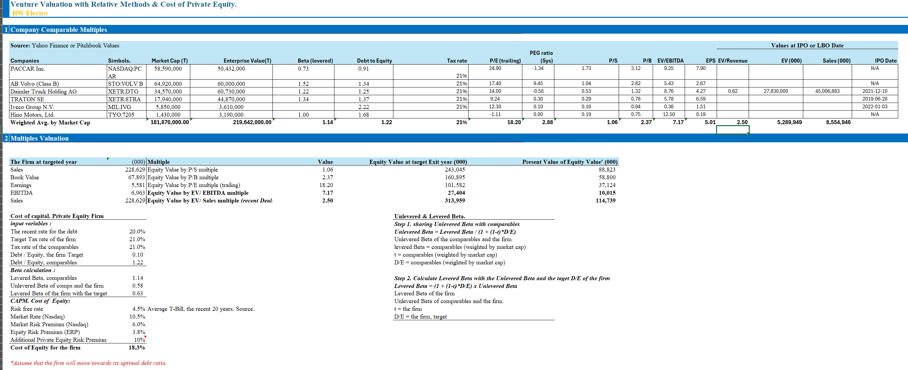
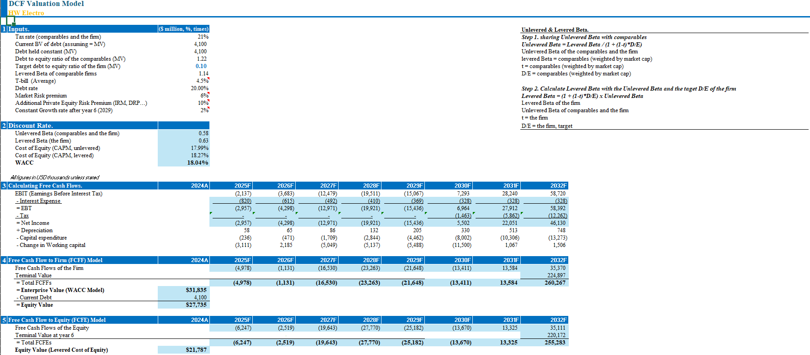
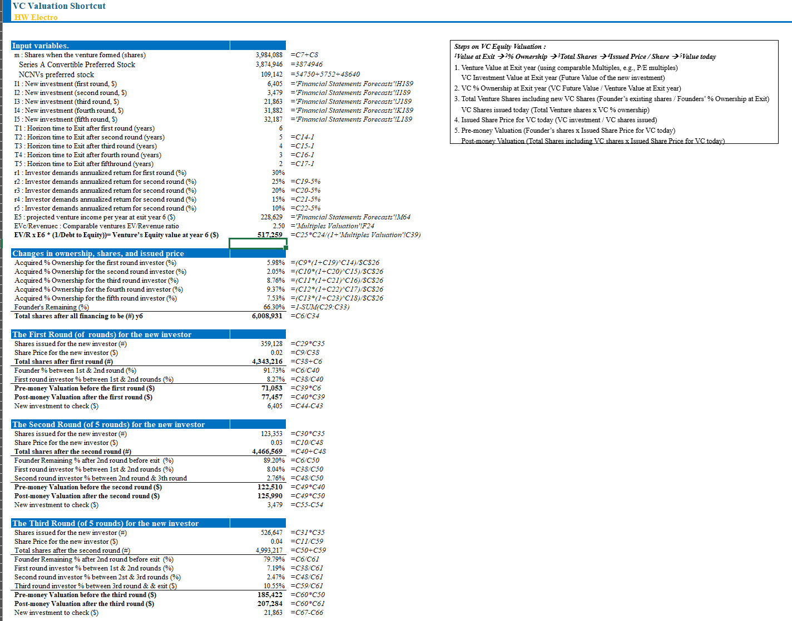
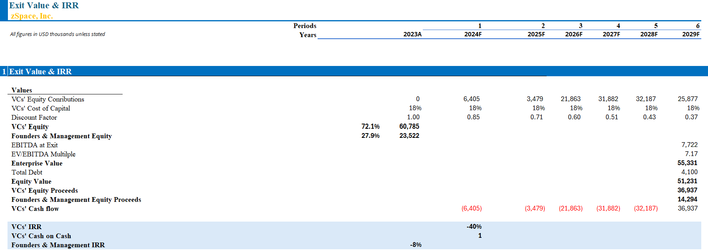

# HW Electro Venture Capital Investment Analysis

Solo project for Venture Capital & Private Equity at Hult International Business School (December 2025). A venture business plan and full valuation of HW Electro, a Tokyo based pre IPO maker of compact commercial electric vehicles for last mile logistics. Company data comes from its public SEC filings.

## Key results (USD)

| Method | Result |
|---|---|
| Cost of capital | WACC 18.04% (CAPM plus a 10% private equity risk premium) |
| Comparable multiples | Implied equity value of $10.0M (EV/EBITDA) to $114.7M (EV/Sales of recent deals), in present value |
| DCF (FCFF) | Enterprise value of about $31.8M |
| DCF (FCFE) | Equity value of about $21.8M |
| VC method | 5 staged rounds totaling about $95.8M; first round of $6.4M at a $71.1M pre money valuation; founders keep about 66% at exit |
| Exit at 7.2x EV/EBITDA | Enterprise value of $55.3M; investor IRR of about negative 40% |

## Method

* Venture business plan: product, Japan's kei vehicle market, the "2024 Problem" in logistics, competition, pricing, operations, management and exit strategy
* Forecast of the income statement, balance sheet and cash flow statement with assumption tables
* Cost of private equity capital: comparable betas unlevered and relevered to the target capital structure, plus a private equity risk premium
* Comparable company multiples: P/S, P/B, P/E, EV/EBITDA and EV/Sales from recent deals
* DCF valuation with FCFF and FCFE
* VC short cut method across 5 funding rounds, with ownership, share price and pre and post money valuation for each round
* Exit models: exit value and IRR, plus an illustrative LBO exit

**Tools:** Excel

## Screenshots

*Comparable multiples valuation*

*DCF valuation with FCFF and FCFE*

*Staged funding rounds, ownership and valuations*

*Exit value and investor returns*

## Files

* [Venture business plan (PDF)](HW_Electro_Business_Plan.pdf)
* [Financial model (Excel)](HW_Electro_VC_Model.xlsx), click "Download raw file" to open it in Excel

## What I learned

The valuation range was very wide. Revenue based multiples valued HW Electro as a growth story, while EBITDA based multiples and the DCF valued it on near term profits. At my base case exit, investors would earn a negative IRR, so the plan only works with a faster revenue ramp, a stronger exit multiple, or less capital per dollar of growth. A model that says "not yet" is a useful answer.
